# Atril · manual para la banda

Atril es una app para Android que junta en el teléfono todo lo que usamos para tocar: la letra con los acordes, la pista para ensayar, la partitura en PDF y la lista de canciones de cada evento. En el escenario la letra se ve grande y avanza sola al ritmo de la música.

Está **en prueba**. Si algo falla o no se entiende, mándale a Christian una captura de pantalla (botón de encendido + bajar volumen) y cuéntale qué estabas haciendo.

**Palabras que vas a ver**

- **Pista**: la grabación de la canción para ensayar encima.
- **Setlist**: la lista de canciones de un evento, en el orden en que se tocan.
- **Tono**: la nota en la que está la canción (G = Sol, Am = La menor…). **Transponer** es subirla o bajarla.
- **BPM**: la velocidad de la canción (golpes por minuto). **Compás**: 4/4, 3/4…
- **Ritmo**: el estilo de la canción: Cumbia, Balada, Vals, Bolero…
- **Cachito**: un pedazo de la pista que guardas con nombre para ensayarlo una y otra vez.

---

## 1. Instalar

1. En tu teléfono Android abre este link: **https://github.com/cSnchzJ/atril-app/raw/main/atril.apk**. Se descarga un archivo llamado `atril.apk`, que es el instalador de la app.
2. Toca el archivo descargado (está en las notificaciones o en la app **Archivos › Descargas**).
3. Android avisa que la app no viene de la Play Store. Toca **Configuración**, activa **Permitir de esta fuente** y regresa con la flecha de atrás.
4. Toca **Instalar** y luego **Abrir**.

> ⚠️ **No desinstales Atril.** Desinstalar borra tus canciones y setlists. Para tener una versión nueva no hace falta: ve el punto 2.

## 2. Actualizar

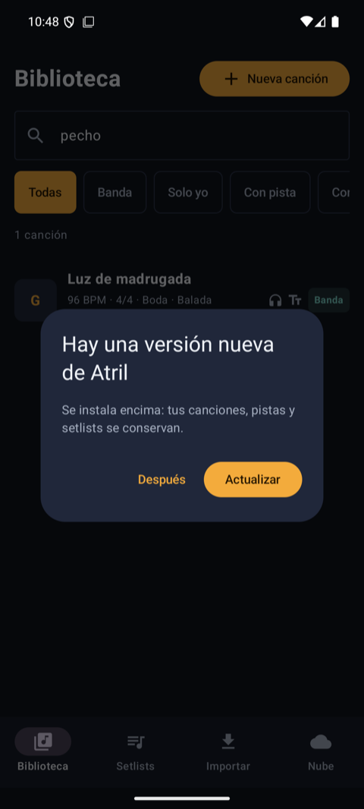

Cuando hay una versión nueva, al abrir Atril aparece este aviso:

1. Toca **Actualizar** y espera unos segundos a que se descargue.
2. Android pregunta si quieres actualizar: toca **Actualizar**.
3. La primera vez, Android pide permiso para que Atril instale apps: toca **Configuración**, activa **Permitir de esta fuente** y regresa.

Se instala encima de la que tienes y **no se pierde nada**. Si tocas **Después**, te lo vuelve a ofrecer la próxima vez que abras la app.

 

## 3. Encontrar una canción

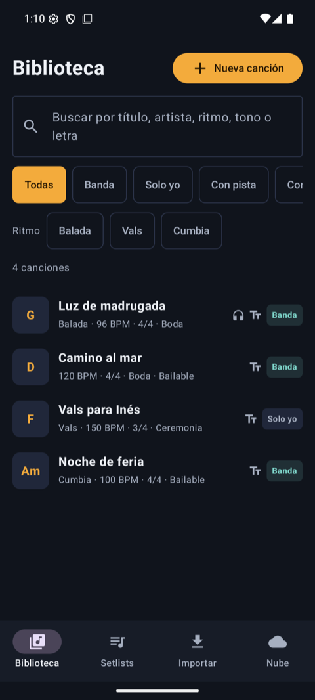 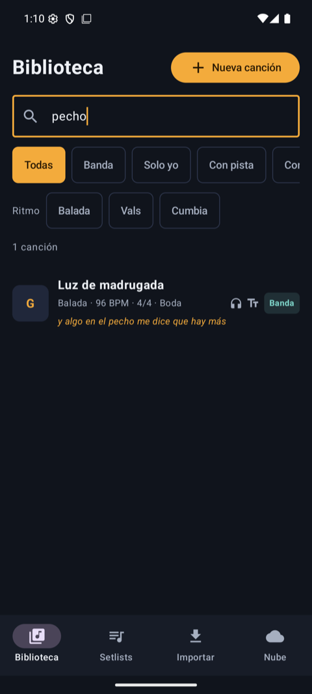

- La pestaña **Biblioteca** tiene todas las canciones. La letra grande de la izquierda es su tono.
- En el **buscador** puedes escribir el título, el artista, el ritmo, el tono o **cualquier palabra de la letra**, y la encuentra aunque no le pongas acentos. Si la palabra está en la letra, te enseña la línea donde aparece.
- Los botones de abajo del buscador filtran: **Banda**, **Solo yo**, **Con pista**, **Con PDF**.
- La fila **Ritmo** muestra los ritmos que hay en tus canciones. Toca uno (por ejemplo **Cumbia**) para ver solo esas; tócalo otra vez para quitar el filtro.

**Mis filtros**

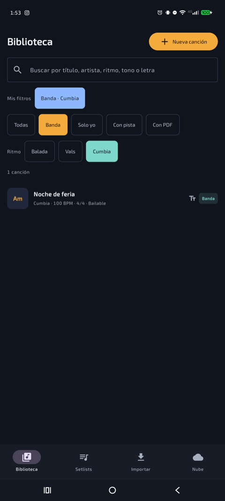

Si siempre buscas lo mismo (por ejemplo, las cumbias de la banda), guárdalo:

1. Elige lo que quieras ver: **Banda**, **Cumbia**, una palabra en el buscador…
2. Toca **＋ Guardar filtro**. Atril propone un nombre («Banda · Cumbia»); cámbialo si quieres y toca **Guardar**.
3. Aparece en **Mis filtros**. Tócalo para verlo otra vez; tócalo de nuevo para quitarlo.
4. **Deja presionado** un filtro para cambiarle el nombre, cambiarlo a lo que estás viendo o borrarlo.

Tus filtros son tuyos: no les aparecen a los demás.

 
- Los íconos de cada canción te dicen qué tiene: 🎧 pista, **Tт** letra, 📄 PDF.

**Agregar una canción nueva**

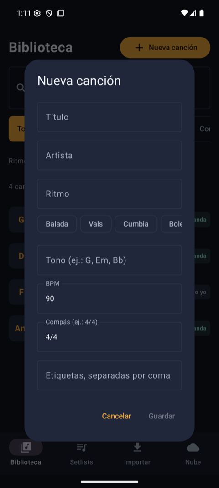

Toca **Nueva canción**, escribe el título y, si quieres, lo demás. Para el **ritmo** basta con tocar uno de los botones de abajo: primero salen los que ya usas y luego los más comunes; también puedes escribir otro. Nada es obligatorio salvo el título, y todo se puede completar después con **Editar datos**.

 

## 4. La ficha de la canción

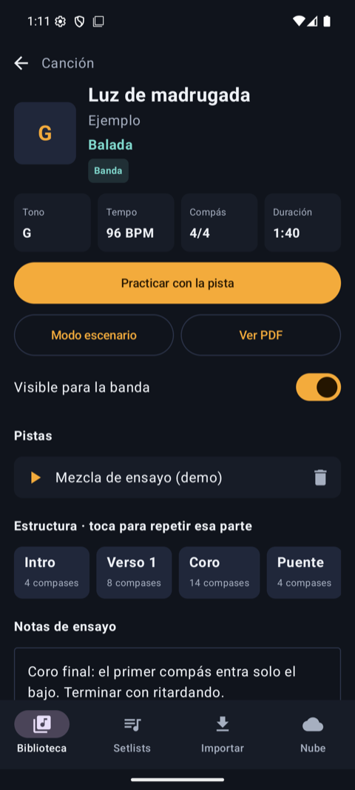

Toca una canción para ver su ficha:

- Arriba están su ritmo, tono, tempo, compás y duración.
- **Practicar con la pista**: la pista con controles para ensayar (punto 5).
- **Modo escenario**: la letra grande para tocar en vivo (punto 6).
- **Ver PDF**: la partitura.
- **Estructura**: las partes de la canción. Toca una (por ejemplo **Coro**) para repetirla una y otra vez.
- **Notas de ensayo**: escribe ahí lo que no se te debe olvidar. Se guarda solo.
- **Visible para la banda**: si está apagado, la canción es **Solo yo** y no se comparte.

 

## 5. Practicar con la pista

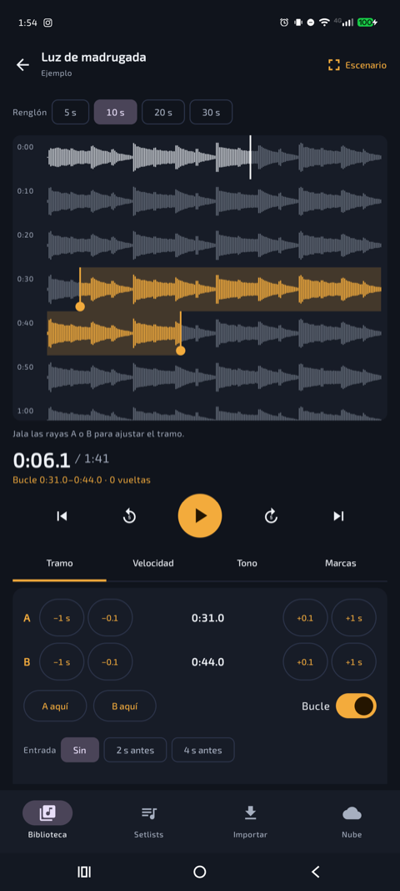 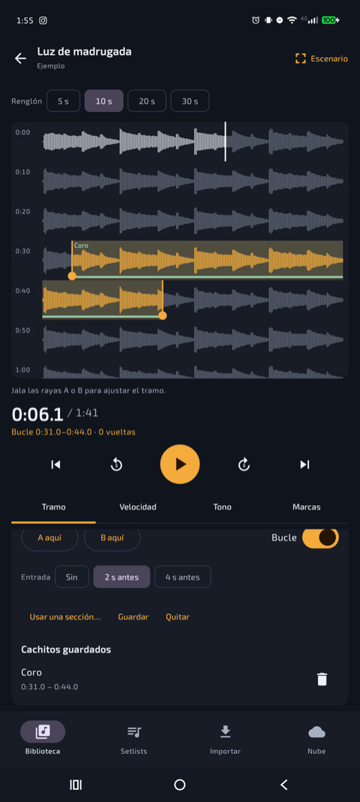

La pantalla tiene tres partes y todo cabe sin bajar:

- **Arriba, la pista como una página de libro**: la onda del audio partida en renglones, con la hora a la izquierda. Así encuentras un punto exacto aunque la grabación dure media hora. Funciona con cualquier audio, aunque no hayas llenado nada de la canción.
- **En medio, la hora y los botones** de reproducir, pausar y saltar.
- **Abajo, las herramientas en pestañas**: **Tramo**, **Velocidad**, **Tono** y **Marcas**. Toca una para cambiar.

- **Renglón 5 s · 10 s · 20 s · 30 s**: qué tanto abarca cada renglón. Con **5 s** puedes ver cada golpe; con **30 s**, recorrer la pista rápido.
- **Toca la onda** y la pista se va a ese punto.
- **Para repetir un pedazo, deja el dedo sobre la onda y arrastra**, como cuando seleccionas texto. Puede abarcar varios renglones. El pedazo queda en naranja con dos rayas, **A** y **B**: jálalas para ajustarlo.
- Mientras suena, la página avanza sola. Si te mueves a otro lado, toca **Ir a donde suena** para regresar.
- En la pestaña **Tramo**:
  - **−1 s, −0.1, +0.1, +1 s** mueven cada borde poquito a poquito, para atinarle al décimo de segundo;
  - **A aquí** y **B aquí** marcan el borde donde va sonando;
  - **Entrada** hace que el pedazo empiece 2 o 4 segundos antes, para que entres a tiempo;
  - **Guardar** le pone nombre al pedazo («Coro», «Solo de guitarra»…) y queda en **Cachitos guardados**: tócalo cuando quieras volver a ensayarlo.
- Pestaña **Velocidad**: ponla en **0.75×** para sacar una parte difícil. Con **Mantener el tono** encendido, la pista va más lenta pero en la misma nota.
- Pestaña **Tono**: con **− / +** sube o baja la pista medio tono por toque. **Original** la regresa.
- Pestaña **Marcas**: **Marcador aquí** marca un punto para regresar a él, y **El compás 1 empieza aquí** sirve para que el modo escenario siga a una grabación que no empieza en el segundo 0.
- La música sigue sonando aunque apagues la pantalla. Para pararla sin abrir la app, baja la barra de notificaciones: ahí está Atril con su botón de pausa.

## 6. En el escenario

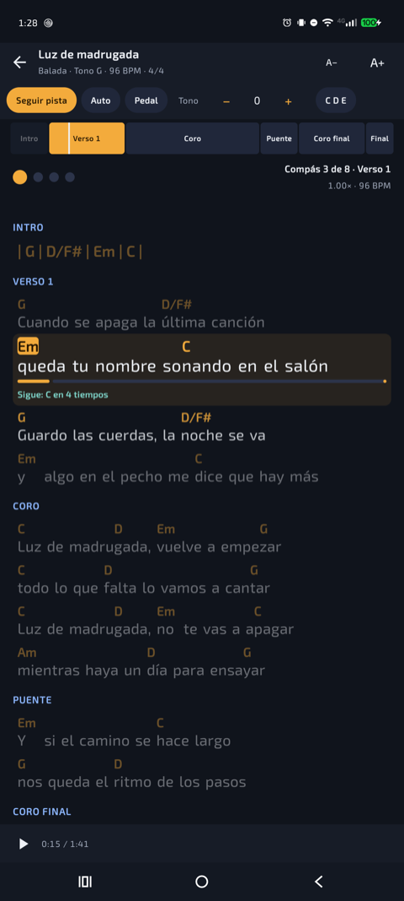

Toca **Modo escenario** en la ficha (o **Escenario**, arriba a la derecha, en el reproductor). La pantalla no se apaga mientras estás aquí.

- **Seguir pista**: la letra avanza sola con la música. La línea que toca se ilumina, abajo dice qué acorde sigue y la barra de arriba marca en qué parte vas. Toca una parte de esa barra para saltar ahí.
- **Auto**: la letra sube sola a una velocidad pareja, que ajustas con **− / +** al final de la barra de botones.
- **Pedal**: avanzas tú, tocando la **parte de abajo** de la pantalla (o la de **arriba** para regresar).
- **A− / A+**: letra más chica o más grande. Atril recuerda el tamaño que elijas.
- **Tono − / +**: transpone todos los acordes. Desliza esa barra hacia la izquierda y al final está **C D E**, que cambia los acordes a **Do Re Mi**.

 

## 7. Setlists

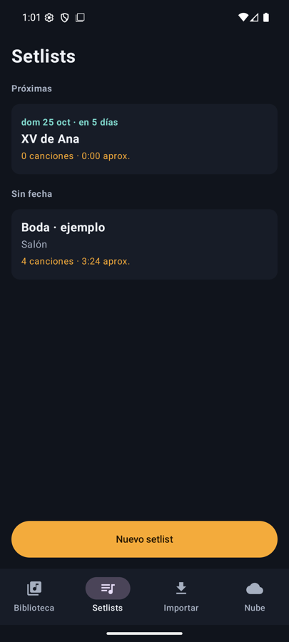 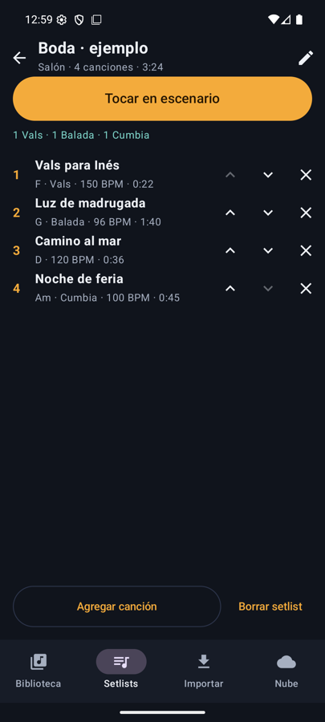

- En la pestaña **Setlists** toca **Nuevo setlist** y ponle nombre, lugar y, si quieres, **fecha**: **Agregar fecha** abre el calendario, y la **✕** la quita.
- Los setlists se ordenan solos: **Próximas** (la tocada más cercana primero), **Sin fecha** y **Ya tocadas**. Cada uno dice cuándo es, por ejemplo «dom 25 oct · en 5 días».
- Dentro del setlist, debajo de **Tocar en escenario**, ves cuántas canciones hay de cada ritmo («1 Vals · 1 Balada · 1 Cumbia»), para balancear la tocada.
- **Agregar canción** abre la lista: toca todas las que quieras y al final **Listo**.
- Las flechas **∧ ∨** cambian el orden y la **✕** quita la canción de la lista (no la borra de la Biblioteca).
- Arriba ves cuántas canciones son y cuánto duran más o menos.
- **Tocar en escenario** las recorre en orden. Abajo dice cuál sigue, y con los botones de los lados pasas a la siguiente o regresas a la anterior.
- **Borrar setlist** borra solo la lista; las canciones se quedan.

 

## 8. Agregar canciones

**Pegar una letra que ya tienes** (pestaña **Importar**)

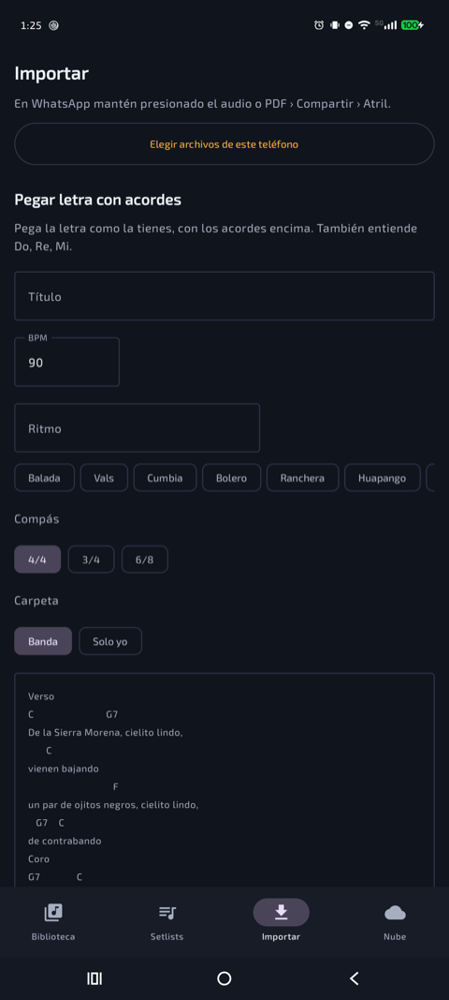

1. Copia la letra con los acordes en la línea de arriba, como se ve en el ejemplo gris. También entiende **Do, Re, Mi** y partes como «Coro:».
2. Escribe el título y, si quieres, el ritmo, el BPM y el compás.
3. Toca **Convertir y guardar**: cada acorde queda sobre su sílaba.

 

**Pasar un audio, PDF, foto o texto desde otra app**

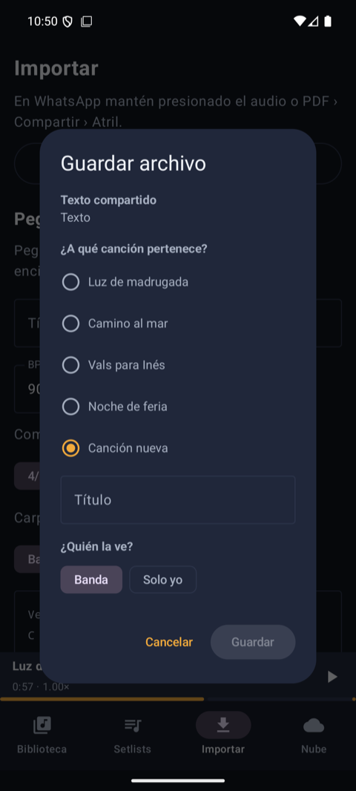

1. En la otra app, mantén presionado el archivo y toca **Compartir** › **Atril**.
2. Atril pregunta **a qué canción pertenece**: elige una o marca **Canción nueva** y escribe su título.
3. Toca **Guardar**.

Los audios pesados se guardan a 128 kbps y las fotos se achican solas, para no llenar el teléfono ni la nube (para ensayar se oye igual). Si mandas un texto a una canción que ya tiene letra, Atril te avisa que la va a reemplazar.

 

---

## Para el futuro

Esto ya está en la app pero **todavía no se ha probado**, así que puede fallar. Si lo usas, cuéntanos cómo te fue.

- **Compartir directo desde WhatsApp.** Compartir funciona desde otras apps del teléfono, pero falta probarlo dentro de WhatsApp.
- **Pedal Bluetooth.** Atril reconoce sus teclas (Av Pág / Re Pág y las flechas) y se probó simulándolas, pero falta un pedal de verdad. Se vincula en **Ajustes › Dispositivos conectados**, como un teclado.
- **Botones de audífonos Bluetooth y controles en la pantalla de bloqueo.** La notificación con pausa sí sale; con la pantalla bloqueada no se ha probado.
- **Mantener el tono al cambiar la velocidad.** La app lo hace, pero nadie lo ha escuchado todavía junto a un instrumento afinado.
- **Recibir las canciones de la banda por Google Drive** (pestaña **Nube**, con la app FolderSync). Se probó en un solo teléfono; falta con varios integrantes, con permisos de solo ver y de editar, y cuando dos personas cambian la misma canción.
- **Archivos muy grandes** (audios de más de 100 MB o PDF de muchas páginas).
- **Tabletas, teléfono acostado y letra del sistema muy grande.**
- **Seleccionar un pedazo largo arrastrando hasta el borde de la página.** La página no avanza sola; para un pedazo largo, selecciona un poco y luego jala la raya **A** o **B**.
